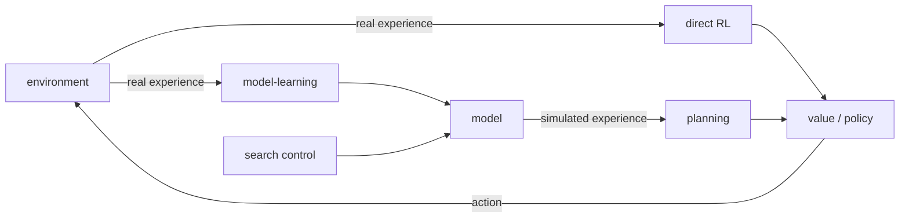

# Models, planning, Dyna (Sutton & Barto, Chapter 8 part a)

> [!abstract] TL;DR
> Planning (computing a policy from a model) and learning (computing one from real experience) are the same activity, estimating value functions by backups, fed by simulated or real experience respectively. Dyna-Q, the simplest agent of the Dyna architecture, runs both side by side: each real step is followed by $n$ planning backups on a learned model, which on a small maze cut the episodes needed for near-optimal performance from about 25 to 3. The rest covers what to do when the model is wrong, where to spend planning backups, and when sampling beats exhaustive backups. Trajectory sampling, heuristic search and Monte Carlo tree search follow in [[08b Trajectory sampling, search, MCTS]].

## Problem

- **Two families, one goal**: methods that need a model of the environment (dynamic programming, heuristic search) and methods that need none (Monte Carlo, temporal-difference) are usually presented as alternatives; the aim is to intermix them. Temporal-difference (TD) methods are the model-free family used throughout.
- **Planning while acting**: when planning runs on-line, new experience can change the model, planning may need to focus on the states currently relevant, and computation must be split between decision-making and model-learning.
- **Imperfect models**: a learned model can be wrong, and planning on a wrong model computes a wrong policy.
- **Limited computation**: in large problems the number of backups affordable is the binding constraint, so the choice of which backups to do (and of what kind) decides how fast values become useful.

## Examples in the chapter

| Example | Setting / decision | What it demonstrates |
|---------|--------------------|----------------------|
| Dyna maze | deterministic gridworld, reach the goal quickly, vary planning steps per real step | planning agents learn from far fewer episodes than a nonplanning one |
| Blocking maze | the short path is closed mid-run and a longer one opens | a model that promises too much errs, but its own failed plans expose the error |
| Shortcut maze | a shorter path opens mid-run while the old one stays usable | a model that hides a new improvement may never be corrected without extra exploration |
| Prioritized sweeping on mazes | the same maze at many grid resolutions | ordering backups by urgency speeds up finding the optimal solution |
| Rod maneuvering | move a rod around obstacles in a large deterministic state space | prioritized sweeping reaches problems too large for unprioritized backups |

## Conceptual framework

- **Model**: anything an agent can use to predict how the environment responds to its actions; given a state and action it predicts the next state and next reward.
  - A **distribution model** gives all possible outcomes with their probabilities.
  - A **sample model** gives one outcome drawn according to those probabilities.
  - For the sum of a dozen dice, a distribution model lists every sum with its probability, and a sample model returns one drawn sum.
  - Dynamic programming assumes a distribution model (see [[04 Dynamic programming]]); the blackjack simulator of [[05a Monte Carlo prediction and control]] is a sample model.
  - A distribution model is stronger, since it can always produce samples, yet a sample model is often much easier to obtain.
- **Simulated experience**: transitions or whole episodes produced by a model, from a starting state and action (sample model: one transition; distribution model: all transitions weighted by probability), or from a starting state and policy.
- **Planning**: any computation that takes a model as input and produces or improves a policy for the modeled environment.
  - **State-space planning** searches the state space for an optimal policy or path, with actions causing transitions and value functions defined over states; it is the kind used here.
  - **Plan-space planning** searches the space of plans, with operators turning one plan into another; it includes evolutionary methods and is hard to apply to the stochastic control problems of reinforcement learning (RL), so it is set aside.
- **Backup**: updating a value estimate toward a value computed from successor estimates, as in [[04 Dynamic programming]]. In this part the word covers both full backups (all possible successors, weighted by probability) and sample backups (one sampled successor).
- **Learning versus planning**: both compute value functions as the key step toward a better policy, by backups; they differ only in the experience source, real from the environment for learning and simulated from a model for planning.
  - Because the structure is shared, a learning algorithm can replace the backup step of a planning method, and learning methods can be run on simulated experience.
  - They still differ in how performance is assessed and how flexibly experience can be generated.
- **Planning in small steps**: planning that advances by small incremental backups can be interrupted or redirected at any time with little wasted computation, which suits mixing it with acting and model-learning.
  - Very small steps may even be the most efficient way to plan when the problem is too large to solve exactly.
- **Roles of real experience in a planning agent**:
  - **Model-learning** uses real experience to make the model match the environment.
  - **Direct RL** uses real experience to improve the value function and policy directly.
  - **Indirect RL** improves them via the model, which is what planning is.
- **Search control**: the process that chooses the starting states and actions of simulated experiences.
- **Branching factor** $b$: the number of possible next states $s'$ with estimated transition probability $\hat p(s'|s,a) > 0$ for a pair $(s,a)$.
- **Optimistic model**: one that predicts more reward or better transitions than the environment gives; the opposite error is a model that hides an improvement the environment now offers.

## Approach

### Planning as backups on simulated experience

1. **Shared structure**: every state-space planning method applies backups to simulated experience, and methods differ only in the kinds of backups, their order, and how long backed-up information is kept.
   - Dynamic programming fits: it sweeps the states, uses each state's distribution of transitions to compute a backup, and updates the state's value.
2. **Random-sample one-step tabular Q-planning**: repeatedly pick a state and an action at random, ask a sample model for one next reward and state, and apply one-step tabular Q-learning to that transition (Q-learning is defined in [[06 Temporal-difference learning]]).
   - It converges to the optimal policy of the model under the conditions that make Q-learning converge in the real environment: every state-action pair is selected infinitely often, and $\alpha$ decreases appropriately.
3. **Indirect versus direct methods**: indirect methods often use a limited amount of experience more fully and reach a better policy with fewer environment interactions.
   - Direct methods are much simpler and are not hurt by biases in the model's design.
   - The contrast is exaggerated; the similarities between the two matter more, much as dynamic programming and temporal-difference learning are close despite one planning and the other learning model-free.

### Dyna-Q

1. **The general Dyna architecture**: real experience feeds both model-learning and direct RL; the model, steered by search control, generates simulated experience; planning applies the same RL method to it as if it had really happened.
   - That one RL method is the "final common path" of learning and planning, so they share almost all machinery and differ only in the source of experience.
   - Conceptually acting, model-learning, direct RL and planning run in parallel; on a serial computer a fixed order inside each time step is specified.
2. **Dyna-Q** is the simplest instance. Acting, model-learning and direct RL take little computation, and the rest of each time step is spent on $n$ planning iterations. Per real step:
   - Choose $A_t$ by $\varepsilon$-greedy with respect to $Q$ (see [[05a Monte Carlo prediction and control]]), execute it, observe $R_{t+1}$ and $S_{t+1}$.
   - **Direct RL**: apply one-step tabular Q-learning to the real transition.
   - **Model-learning**: store in the model entry for $(S_t, A_t)$ the prediction that $R_{t+1}, S_{t+1}$ follow deterministically. A query for a seen pair returns the last observed next state and reward.
   - **Planning**, repeated $n$ times: pick a previously observed state and an action previously taken in it at random, query the model, apply the same Q-learning update to the simulated transition. Sampling only seen pairs means the model is never asked about a pair it knows nothing about.
   - Without the model-learning and planning steps this is plain one-step tabular Q-learning, the $n = 0$ case.
3. **Dyna maze results**: in a maze of 47 states, reward $+1$ only on entering the goal, $\gamma = 0.95$, $\alpha = 0.1$, $\varepsilon = 0.1$, initial values zero, averaged over 30 runs.
   - The first episode takes about 1700 steps for every $n$; afterwards all agents improve, larger $n$ much faster.
   - Episodes to reach (near-)optimal performance: about 25 for $n = 0$ (whose $\alpha$ and $\varepsilon$ were tuned for it), about 5 for $n = 5$, about 3 for $n = 50$.
   - Why: halfway through the second episode the nonplanning agent has learned one step of the policy, the last one before the goal, whereas the $n = 50$ agent has built an extensive policy that will reach almost back to the start by the episode's end, while it is still wandering near the start.
4. **Always reactive and always deliberative**: the agent responds instantly to the latest information and plans in the background. As the model changes with new information, ongoing planning gradually computes behavior matching the new model.

### When the model is wrong

1. **Sources of error**: limited samples of a stochastic environment, imperfect generalization when the model is learned with function approximation, or an environment that changed in a way not yet observed.
2. **Optimistic errors correct themselves**: the planned policy tries to exploit the imagined opportunity and discovers it does not exist.
   - In the blocking maze all three Dyna agents (Dyna-Q; Dyna-Q+, described below; and Dyna-AC, a Dyna agent with an actor-critic learner as in [[11 Policy approximation (actor-critic)]]) lost reward for a while after the change, then found the new route.
3. **Errors that hide an improvement do not**: in the shortcut maze two of three agents never found the new short path. Their models said there was none, so planning made stepping toward it less likely, and $\varepsilon$-greedy exploration is very unlikely to produce so many exploratory actions in a row.
4. **Exploration in planning**: exploration here means trying actions that improve the model, and exploitation means acting optimally for the current model. There is probably no perfect, practical solution, but simple heuristics often work.
5. **Dyna-Q+** is such a heuristic (the one agent that solved the shortcut maze): it tracks, for each state-action pair, the time steps since the pair was last tried in the real environment, and adds a bonus reward to simulated experience of long-untried pairs.
   - The longer a pair has gone untested, the more plausible that its dynamics changed and the model is stale.
   - The bonus makes the agent test all reachable transitions and even plan long action sequences to carry out such tests; the testing costs performance, but in the shortcut maze it paid off.
   - Two further changes: actions never tried before from a state may be chosen in planning, and the initial model for them is that they lead back to the same state with reward zero.

### Prioritized sweeping

1. **The problem with uniform planning**: Dyna picks simulated starting pairs uniformly among experienced ones. Early on in the maze nearly every backup moves value between two zero-valued states and changes nothing; only backups into the state just before the goal, or from it into the goal, do.
2. **Work backward from changed values**: not just from goal states, which are only a convenient special case, but from any state whose value changed.
   - Only backups of actions leading directly into a changed state can be useful; if they change, their predecessor states may in turn need updating, and so on until the effect dies out.
3. **Prioritize by urgency**: the frontier of useful backups grows fast and some pairs matter more than others, since predecessors of a state that changed a lot are more likely to change a lot too.
   - Keep a queue of every state-action pair whose value would change nontrivially if backed up, ordered by the size of the change.
   - Back up the top pair, compute the effect on each of its predecessor pairs, and insert a predecessor whose effect exceeds a small threshold; a pair already queued keeps only its higher priority.
   - Effects propagate backward until no queued change remains.
4. **Results**: on mazes of the same structure as the Dyna maze at many resolutions, prioritized sweeping found optimal solutions often 5 to 10 times faster than unprioritized Dyna-Q, both doing at most $n = 5$ backups per environment interaction. On the rod-maneuvering task (14,400 potential states, deterministic, rod moved in steps of about $1/20$ of the workspace and rotated in $10$ degree steps) it solved a problem probably too large for unprioritized methods.
5. **Stochastic environments**: the model keeps counts of how often each pair was experienced and what the next states were, and each pair is backed up with a full backup over all possible next states rather than a sample backup.

### Full versus sample backups

1. **Three binary dimensions of one-step backups**: whether they back up state or action values, whether they estimate the optimal policy or a given one, and whether they are full or sample. That gives eight cases, seven of which are named algorithms (the eighth, a sample backup of $v_*$, seems useless).

   The named algorithms are defined in [[04 Dynamic programming]] and [[06 Temporal-difference learning]]; Q-policy evaluation and Q-value iteration are the full backups for $q_\pi$ and $q_*$.

   | Value estimated | Full backup (dynamic programming) | Sample backup (one-step TD) |
   |-----------------|-----------------------------------|-----------------------------|
   | $v_\pi$ | policy evaluation | TD(0) |
   | $v_*$ | value iteration | none |
   | $q_\pi$ | Q-policy evaluation | Sarsa |
   | $q_*$ | Q-value iteration | Q-learning |

   - Any of them can serve in planning. Dyna-Q uses $q_*$ sample backups but could use $q_*$ full backups or $q_\pi$ backups of either kind; Dyna-AC uses $v_\pi$ sample backups.
   - For stochastic problems prioritized sweeping always uses a full backup.
2. **The question**: full backups give better estimates because they have no sampling error, but cost more, and computation is the limiting resource in planning, so the comparison must hold computation fixed.
3. **When they differ**: only to the extent that the environment is stochastic. With a single possible next state the two are identical (taking $\alpha = 1$).
4. **Cost**: computation is dominated by the number of state-action pairs at which $Q$ is evaluated, so a full backup of a pair costs roughly $b$ times a sample backup.
   - With time to finish a full backup, it is generally better than $b$ sample backups.
   - Without it, sample backups are always preferable, since they improve the estimate with fewer than $b$ backups. In a large problem a few sample backups at many pairs beat full backups at a few.
5. **Analysis**: take all $b$ successors equally likely, initial error 1 and correct successor values, so a full backup ends with error 0. Sample backups with $\alpha = 1/t$ (sample averages) have error given in Math.
   - For moderately large $b$ the error falls dramatically after a tiny fraction of $b$ backups, so many pairs can be improved to within a few percent of a full backup in the time one pair gets one full backup.
   - This understates the advantage: in practice successor values are themselves estimates, and sample backups make them accurate sooner, which makes later backed-up values more accurate.
   - Conclusion: sample backups likely beat full backups on problems with large stochastic branching factors and too many states to solve exactly.

## Math

**Notation.**

| Symbol | Meaning |
|--------|---------|
| $S_t, A_t$ | state and action at step $t$, as in earlier notes |
| $R_{t+1}, S_{t+1}$ | reward and next state observed after $A_t$ |
| $S, A, R, S'$ | a state-action pair and the reward and next state of one transition, real or simulated |
| $s, a, s', r$ | generic state, action, next state, reward in a backup |
| $Q(s,a)$ | tabular estimate of the action value, approximating $q_*$ |
| $\mathrm{Model}(s,a)$ | model entry: predicted reward and next state for the pair $(s,a)$ |
| $\hat p(s',r \mid s,a)$ | estimated dynamics (distribution model) |
| $n$ | planning backups per real step |
| $\alpha$, $\gamma$, $\varepsilon$ | step size, discount rate, exploration probability |
| $\tau$ | time steps since a pair was last tried in the real environment |
| $\kappa$ | small weight of the exploration bonus |
| $P$, $\theta$ | priority of a pair (size of the change a backup would make) and the threshold for queueing |
| $\bar S, \bar A, \bar R$ | a predecessor pair of the state just backed up, and its predicted reward |
| $b$, $t$ | branching factor; number of sample backups done |

**Q-learning backup, applied to real or simulated transitions** (direct RL, and the planning step of Dyna-Q and Q-planning):

$$
Q(S,A) \leftarrow Q(S,A) + \alpha \Big[ R + \gamma \max_a Q(S',a) - Q(S,A) \Big]
$$

- Estimates $q_*$ with a sample backup; only the source of $(S,A,R,S')$ differs: the environment for learning, the model for planning.

**Deterministic model update in Dyna-Q:**

$$
\mathrm{Model}(S_t, A_t) \leftarrow R_{t+1}, S_{t+1}
$$

- Assumes a deterministic environment; the entry is overwritten by the latest observation.

**Exploration bonus of Dyna-Q+:**

$$
R + \kappa \sqrt{\tau}
$$

- Used in place of the modeled reward $R$ in planning backups of a transition untried for $\tau$ steps; the bonus grows with the time since the pair was last tried.

**Priority in prioritized sweeping** (deterministic environment):

$$
P \leftarrow \Big| R + \gamma \max_a Q(S',a) - Q(S,A) \Big|
$$

- The size of the change a backup of $(S,A)$ would make. If $P > \theta$ the pair enters the queue with priority $P$. After backing up the top pair, the same expression is evaluated for each predecessor $\bar S, \bar A$ predicted to lead to $S$, with $\bar R$ and $Q(\bar S, \bar A)$ in place of $R$ and $Q(S,A)$ and with $S$ as the next state.

**Full backup for $q_*$** (distribution model, tabular $Q$):

$$
Q(s,a) \leftarrow \sum_{s',r} \hat p(s',r \mid s,a) \Big[ r + \gamma \max_{a'} Q(s',a') \Big]
$$

- Exact given the successor values; costs about $b$ evaluations of $\max_{a'} Q$. The corresponding sample backup is the Q-learning backup above with one $S', R$ drawn from the model: it costs one evaluation but carries sampling error, and equals the full backup when only one next state is possible and $\alpha = 1$.

**Error of sample backups** (successors equally likely, initial error 1, successor values correct, $\alpha = 1/t$):

$$
\sqrt{\frac{b-1}{b\,t}}
$$

- Root-mean-square (RMS) error of the estimate after $t$ sample backups; a full backup brings it to 0 after $b$ evaluations.

> [!example] Worked intuition
> Formalized here from the error formula. With $b = 1000$, $t = 10$ sample backups (1% of the cost of a full backup) give $\sqrt{999/10000} \approx 0.32$, and $t = 100$ (10% of the cost) give $\sqrt{999/100000} \approx 0.10$. The cost of one full backup therefore buys either 10 pairs at error about $0.10$ each or 100 pairs at about $0.32$ each, and even $t = b$ gives only $\approx 0.03$.

## Dataset example

One row per real step of a Dyna-Q agent, plus the planning backups that follow it; illustrative rows (the book prints no such table). Corridor $A \to B \to C \to G$, action `right` only for brevity, reward $+1$ on entering the terminal goal $G$ and 0 otherwise, $\gamma = 0.95$, $\alpha = 0.1$, all $Q$ initially 0, first episode, $n = 2$ planning backups after every real step (the ones after the first two steps change nothing, since all values are still 0; the rows show the step that changes values).

| source | $S$ | $A$ | $R$ | $S'$ | model entry written or read | $Q(S,A)$ after backup |
|--------|-----|-----|-----|------|-----------------------------|------------------------|
| real, $t=0$ | A | right | 0 | B | writes $\mathrm{Model}(A,\text{right}) = (0,B)$ | 0 |
| real, $t=1$ | B | right | 0 | C | writes $\mathrm{Model}(B,\text{right}) = (0,C)$ | 0 |
| real, $t=2$ | C | right | 1 | G (terminal) | writes $\mathrm{Model}(C,\text{right}) = (1,G)$ | 0.1 |
| planning 1 | B | right | 0 | C | reads $(0,C)$ | 0.0095 |
| planning 2 | A | right | 0 | B | reads $(0,B)$ | 0.00090 (rounded) |

- **Column to symbol**: source real rows are the transitions $(S_t, A_t, R_{t+1}, S_{t+1})$; planning rows take $(S,A)$ from previously observed pairs and $R, S'$ from $\mathrm{Model}(S,A)$.
- **Derived**: with the terminal goal's successor value taken as 0 (formalized here), the third row gives $0 + 0.1\,(1 - 0) = 0.1$. Planning 1 gives $0 + 0.1\,(0 + 0.95 \cdot 0.1 - 0) = 0.0095$ using $Q(C,\text{right}) = 0.1$, and planning 2 gives $0.1\,(0.95 \cdot 0.0095) \approx 0.00090$. Without planning, only the last row's value would have changed.
- **Absent**: any transition not yet experienced; the model is never queried for it. The same rows in a prioritized-sweeping agent would queue $(C,\text{right})$ with $P = 1$ and then $(B,\text{right})$ with $P = 0.095$ (formalized here) instead of sampling uniformly.

## Where it matters in practice

### Signs a problem fits

- A model is available or learnable and real interactions are scarce or slow, so squeezing more value updates out of each one pays.
- A large stochastic branching factor with too many states to solve exactly favors sample backups.
- The environment may change over time, so that stale model entries are a real risk worth explicit exploration.

### What you need to use it

- **Model**: a sample model suffices for sample backups and for Dyna-Q; a distribution model is needed for full backups and for the stochastic form of prioritized sweeping.
- **State space**: discrete and tabular, observed exactly.
- **Compute**: spare computation per real step for $n$ planning backups.
- **Exploration**: a rule that also tests the model, beyond $\varepsilon$-greedy, if the environment can change.

### When not to trust it

- When the model may be stale and nothing forces re-testing it: planning reinforces the error.
- When states are not enumerable: prioritized sweeping relies on discrete states and on finding every predecessor of a changed state, and with function approximation a single backup can influence many states with no evident way to find them efficiently (see [[09a Function approximation and linear methods]]).

## Assumptions & limitations

- **Dyna-Q's model-learning** is the simplest possible; stochastic or changing dynamics are handled only through the heuristics above.
- **Prioritized sweeping** is given for deterministic, discrete-state problems; more general versions are left to further research, though focusing on changed states and then their predecessors seems valid in general.
- **Full versus sample analysis** is an idealized comparison (equally likely successors, correct successor values).
- **Scope**: only one-step backups and tabular representations are analyzed here.
