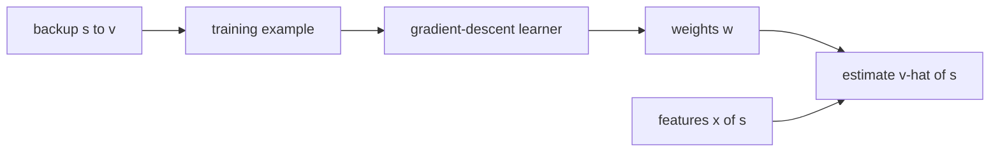

# Function approximation and linear methods (Sutton & Barto, Chapter 9 part a)

> [!abstract] TL;DR
> When there are too many states for a table, the value function is stored as a parameterized function $\hat v(s,\mathbf{w})$ and every update target (Monte Carlo (MC), temporal-difference (TD), dynamic programming (DP)) is treated as a training example for ordinary gradient-descent learning, so one update changes the value of many states. The linear case, where $\hat v$ is a weighted sum of features of the state, is the best understood; how the features are built (coarse, tile, radial-basis or Kanerva coding) decides how learning generalizes.

This is part a of two. Part b, [[09b Control with approximation, bootstrapping]], extends the methods to action values and control and to bootstrapping questions. This note covers prediction only: estimating $v_\pi$ for a fixed policy $\pi$ ($v_\pi$ and returns in [[03b MDPs, value functions, optimality]]; Monte Carlo targets in [[05a Monte Carlo prediction and control]]; TD(0) in [[06 Temporal-difference learning]]; the $\lambda$-return, TD($\lambda$) and eligibility traces in [[07a n-step TD and TD(λ)]]).

## Problem

- **Tables do not scale**: a table with one entry per state (or per state-action pair) needs memory for every entry and, more importantly, the time and data to fill every entry accurately.
- **Most states are new**: in tasks with continuous variables or complex sensations such as images, most states met will never have been seen exactly before, so learning anything requires generalizing from visited states to unvisited ones.
- **The tool exists already**: generalization from examples is function approximation, an instance of supervised learning, so reinforcement learning (RL) mostly needs to be combined with existing methods, not to invent new ones.
- **Limited resolution**: the number of parameters is far below the number of states, so even with exact target values no setting of the parameters makes every state correct. Accuracy at some states is bought with error at others.
- **Not every supervised method fits**: RL needs methods that learn on-line from incrementally arriving data, and that cope with targets that drift (see Conceptual framework).

## Examples in the chapter

| Example | Setting / decision | What it demonstrates |
|---------|--------------------|----------------------|
| Coarseness of coarse coding | learn a one-dimensional square-wave function from uniformly random training points, with narrow, medium or broad interval features of equal density (about 50 over the function's extent), step size $\alpha = 0.2/m$ with $m$ the number of features present, after 10 up to 10,240 training examples | feature width strongly shapes early generalization but barely changes the final fit |
| Pole balancing (mentioned; see [[03a MDP setting and returns]]) | the state includes the pole's angle and angular velocity | why a linear form needs features for combinations of qualities, since the same angular velocity is good or bad depending on the angle |

## Conceptual framework

- **Parameterized value function**: $\hat v(s,\mathbf{w}) \approx v_\pi(s)$ with weight vector $\mathbf{w}\in\mathbb{R}^n$; it can be a neural network (the weights are connection strengths) or a decision tree (the parameters are split points and leaf values).
  - $n$ is typically much smaller than the number of states, and changing one weight changes the estimate at many states.
  - So a backup at one state generalizes to others.
- **Backup as a training example**: a backup $s \mapsto v$ names the state $s$ and the target $v$ its estimate should move toward. Every prediction method so far fits this form:
  - MC: $S_t \mapsto G_t$.
  - TD(0): $S_t \mapsto R_{t+1} + \gamma\hat v(S_{t+1},\mathbf{w}_t)$.
  - TD($\lambda$): $S_t \mapsto G_t^{\lambda}$, the $\lambda$-return built from $\hat v$.
  - DP policy evaluation: $s \mapsto \mathbb{E}_\pi[R_{t+1} + \gamma\hat v(S_{t+1},\mathbf{w}_t) \mid S_t = s]$, where $s$ is an arbitrary state, unlike the others, which back up the state met in (possibly simulated) experience.
- **What changes**: with a table the update shifts one entry a fraction of the way to the target; now any function approximation method may implement the backup, by being given $s \mapsto v$ as an input-output example.
- **Requirements RL puts on the approximator**:
  - It must learn on-line from data that arrive incrementally, whereas the most sophisticated neural-network and statistical methods assume a fixed training set swept many times.
  - It must handle **nonstationary targets**, ones that change over time: in generalized policy iteration (GPI) control the learned value changes as the policy changes, and even for a fixed policy bootstrapped targets (DP, TD) shift as the estimates shift.
- **Error measure**: the root-mean-squared error (RMSE) of $\hat v$ against $v_\pi$, weighted by a state distribution $d$ that says how much each state's error matters, since errors cannot all be zero.
  - It is assumed throughout that $d$ is also the distribution of the states being backed up.
- **On-policy distribution**: the frequency with which states are met while acting by $\pi$, the policy whose value is approximated.
  - Minimizing error under it spends the approximator's capacity on states that actually occur and ignores those that never do.
  - It is the natural distribution for MC and TD, which back up each state they encounter, so their training examples come in this distribution automatically.
- **Optima**: a **global optimum** $\mathbf{w}^*$ has RMSE no larger than any other weight vector; a **local optimum** has RMSE no larger than any weight vector in a neighborhood of it.
- **Gradient**: for a function $f(\mathbf{w}_t)$, $\nabla f(\mathbf{w}_t)$ is the vector of its partial derivatives with respect to the components of $\mathbf{w}_t$; moving against it reduces $f$ fastest.
- **Linear function approximation**: $\hat v$ is linear in $\mathbf{w}$, a weighted sum of a **feature vector** $\mathbf{x}(s)$ of the state.
  - Features are chosen by the designer, which is how prior domain knowledge enters.
- **Receptive field**: the region of state space in which a feature is present (nonzero); it sets how far learning at one state spreads.
- **Binary feature**: a feature that is 1 (present) or 0 (absent).

## Approach

1. **Framework**: pick a state distribution $d$ and an RMSE goal, feed each backup to a supervised learner, and read the learned function as the value estimate.
   - The method space is too large to survey, so the rest of this note takes gradient methods, and linear ones in particular: they are promising, reveal the key theoretical issues and are simple.
2. **Gradient descent on the example's error**: after each example, shift $\mathbf{w}$ a small step against the gradient of that example's squared error.
   - Only a small step is taken on purpose: fully correcting each example would erase the balance of errors across states that the approximator is meant to find.
   - The convergence results assume the step size $\alpha$ decreases over time under the standard stochastic approximation conditions (the ones given in [[02 Multi-armed bandits]]); then the method converges to a local optimum.
3. **Substituting a target for the true value**: the exact value $v_\pi(S_t)$ is unknown, so the update uses a target $V_t$, which may be noisy or itself a backed-up value.
   - If $V_t$ is **unbiased**, $\mathbb{E}[V_t] = v_\pi(S_t)$, the weights converge to a local optimum under the same conditions.
   - **Monte Carlo target** $V_t = G_t$ is unbiased by definition of $v_\pi$, so gradient-descent MC converges to a locally optimal approximation.
   - **$\lambda$-return target** $V_t = G_t^\lambda$ with $\lambda<1$, like DP targets, is biased since it contains $\hat v$ itself, and the method does not converge to a local optimum; such bootstrapping methods nonetheless often work well, with other guarantees for special cases.
   - The increments of bootstrapped methods are not true gradients; the useful view is gradient descent with a bootstrapped target in place of $v_\pi(S_t)$.
4. **Gradient-descent TD($\lambda$)**: the forward view is the update toward $G_t^\lambda$; the backward view applies the TD error to a vector of eligibility traces, one trace per weight, instead of one per state.
   - The traces accumulate the gradients of recently visited states and decay by $\gamma\lambda$ per step.
   - The complete on-line algorithm is given in Math.
   - Neural networks trained by error backpropagation fit these equations directly, backpropagation being the way the gradient is computed; the linear form is the other widely used choice.
5. **Linear methods**: $\hat v$ is a dot product of weights and features, so the gradient is the feature vector and every update above becomes simple.
   - There is a single optimum (or one set of equally good optima), so a method that converges to or near a local optimum converges to or near the global one.
   - Almost all useful convergence results for learning systems are for linear or simpler methods.
   - Gradient-descent TD($\lambda$) is proved to converge in the linear case, under decreasing step sizes, to a weight vector near the best one, within an error bound given in Math; as $\lambda \to 1$ the bound approaches the minimum error.
   - A similar bound covers other on-policy bootstrapping methods; linear gradient-descent DP backups with the on-policy distribution converge to the same result as TD(0).
   - It depends on backups following the on-policy distribution: with other distributions, bootstrapping methods with function approximation may diverge to infinity.
6. **Features carry the prior knowledge**: how efficient a linear method is, in data and computation, depends on the state-to-feature representation.
   - Features should match the natural features of the task, those along which generalization is appropriate (for a mobile robot, locations, remaining battery power, sonar readings).
   - A linear form cannot express interactions between features (feature $i$ is good only when feature $j$ is absent), so features for conjunctions of values must be added.

### Coarse coding

- **Idea**: for a continuous state, define features as overlapping regions (for example circles in a plane), each with one binary feature that is 1 when the state lies inside; the pattern of present features codes the location coarsely.
- **Learning**: each region has one weight, so training at a state $X$ changes the weights of every region containing $X$, and thus the value at every point within their union, more strongly the more regions the point shares with $X$.
- **Size and shape of fields set generalization**: small fields generalize over short distances, large ones over long distances, and elongated ones in the direction of the elongation.
- **Acuity is set by the feature count**: large fields do not cap the sharpness of the learned function; the finest discrimination ultimately possible is governed more by the total number of features than by field width.

### Tile coding

- **Structure**: receptive fields are grouped into exhaustive partitions of the input space; each partition is a **tiling**, each of its cells a **tile**, and each tile is one binary feature.
  - Exactly one tile is present per tiling, so the number of present features equals the number of tilings $m$ for every state.
- **Step size**: since $m$ is fixed, $\alpha$ can be set intuitively as a fraction of $1/m$ (rule and worked case in Math).
- **Cheap computation**: the estimate is a sum of just the $m$ weights of the present tiles, not $n$ multiplications; and the gradient components are 0 or 1, which also simplifies the trace update.
- **Layout**: gridlike tilings make finding the present tiles easy; several tilings are used, each offset differently.
  - Offsets can be random or carefully designed; shifting every dimension by the same increment is known to be a poor choice.
  - In the book's illustration, an extra row and column of tiles is added so that no point is left uncovered.
- **Shape and density**: tile width and shape set how far generalization reaches; the number of tilings sets the density of tiles, trading finer accuracy for higher computational cost.
  - Tilings need not be uniform grids: irregular tiles, stripes (generalizing along the stripes and discriminating across them) and diagonal stripes are possible; in higher dimensions axis-aligned stripes mean some tilings ignore some dimensions.
- **Hashing**: a consistent pseudo-random collapse of a large tiling into a much smaller set of tiles, each made of scattered disjoint regions.
  - It often cuts memory by large factors with little loss of performance, because high resolution is needed in only a small part of the state space.
  - Memory then need not grow exponentially with dimension, only with what the task demands.

### Radial basis functions

- **What they are**: radial basis functions (RBFs) generalize coarse coding to features with any value in $[0,1]$, expressing a degree of presence; a typical feature has a bell-shaped response that depends on the distance of the state from the feature's center state.
- **RBF network** (radial basis function network): a linear approximator with these features, learned exactly as other linear methods.
- **Advantage over binary features**: the approximate function varies smoothly and is differentiable.
- **Nonlinear variants**: some methods also adapt the centers and widths; they may fit the target much more precisely; the downside of radial basis function networks, nonlinear ones especially, is greater computation and often more manual tuning before learning is robust and efficient.

### Kanerva coding

- **Why another method**: tile coding and RBF networks grow in cost exponentially with the number of dimensions; tricks such as hashing help only up to a few tens of dimensions, so hundreds of dimensions are impractical.
- **Complexity of the target is the real issue**: a function approximator of a given complexity can only approximate targets of comparable complexity. In the worst case target complexity grows with the state space, which is exponential in dimension, but short of that, complexity and dimension can be unrelated (a 1000-dimensional task where only one dimension matters).
  - Ideally, extra sensors or dimensions would cost almost nothing when the needed approximation does not get more complex, and cost should grow in proportion to the target's complexity.
- **Method**: binary features that correspond to prototype states (for definiteness, chosen at random from the whole state space); a feature's receptive field is all states sufficiently close to its prototype.
  - For a binary state space the distance is the Hamming distance, the number of bits at which two states differ, so states count as similar when they agree on enough dimensions even if they differ wholly on others.
- **Result**: the complexity of learnable functions depends on the number of features, which has no necessary relation to the task's dimension; only in the worst case must it be exponential in it.
  - Complex functions still need more features.
  - There is little experience with such systems; what exists suggests their ability grows in proportion to computational resources.

## Math

**Notation.** Time-step symbols match earlier notes. New here: the weight vector, the approximate value and the feature vector; $\hat v$ replaces the tabular $V$.

| Symbol | Meaning |
|--------|---------|
| $S_t$, $R_{t+1}$, $G_t$ | state, next reward and return at time $t$, as in earlier notes |
| $\pi$, $v_\pi$, $\gamma$, $\alpha$, $\lambda$ | policy, its true state-value function, discount, step size, trace decay, as in earlier notes |
| $\mathcal{S}$ | the state set |
| $\mathbf{w}$, $\mathbf{w}_t$ | weight (parameter) vector in $\mathbb{R}^n$ and its value at step $t$; components $w_i$ |
| $n$ | number of weights (and of features) |
| $\hat v(s,\mathbf{w})$ | approximate value of state $s$ under weights $\mathbf{w}$; target of approximation is $v_\pi(s)$ |
| $s \mapsto v$ | backup: state $s$ and the target $v$ its estimate is shifted toward |
| $V_t$ | target of the $t$-th training example $S_t \mapsto V_t$ (any approximation of $v_\pi(S_t)$; here a number, not the tabular $V$) |
| $d(s)$ | distribution over states weighting the errors, $\sum_s d(s) = 1$ |
| $\mathbf{w}^*$, $\mathbf{w}_\infty$ | best weight vector (minimum RMSE) and the weights TD($\lambda$) converges to |
| $\nabla$ | gradient with respect to $\mathbf{w}$ |
| $G_t^{\lambda}$ | $\lambda$-return of time $t$ (called $L_t$ in [[07a n-step TD and TD(λ)]]; the same quantity) |
| $\delta_t$ | TD error, now computed with $\hat v$ |
| $\mathbf{e}_t$ | vector of eligibility traces, one component per weight, $\mathbf{e}_0 = \mathbf{0}$ |
| $\mathbf{x}(s)$, $x_i(s)$ | feature vector of state $s$ and its $i$-th feature; same length as $\mathbf{w}$ |
| $m$ | number of features present at one time (equal to the number of tilings in tile coding) |
| $c_i$, $\sigma_i$ | center state and width of the $i$-th radial basis feature |



**Root-mean-squared error over a state distribution:**

$$
\mathrm{RMSE}(\mathbf{w}) = \sqrt{\sum_{s\in\mathcal{S}} d(s)\Big[v_\pi(s) - \hat v(s,\mathbf{w})\Big]^2}
$$

- States with larger $d(s)$ count more.

**Gradient-descent update with the true value:**

$$
\mathbf{w}_{t+1} = \mathbf{w}_t - \tfrac{1}{2}\alpha \nabla\Big[v_\pi(S_t) - \hat v(S_t,\mathbf{w}_t)\Big]^2 = \mathbf{w}_t + \alpha\Big[v_\pi(S_t) - \hat v(S_t,\mathbf{w}_t)\Big]\nabla\hat v(S_t,\mathbf{w}_t)
$$

- A step proportional to the negative gradient of the example's squared error; the factor $\tfrac12$ cancels the 2 from differentiating the square.

**General gradient-descent update for state-value prediction:**

$$
\mathbf{w}_{t+1} = \mathbf{w}_t + \alpha\Big[V_t - \hat v(S_t,\mathbf{w}_t)\Big]\nabla\hat v(S_t,\mathbf{w}_t)
$$

- Estimates $v_\pi$; the target $V_t$ replaces the unknown true value.
- MC uses $V_t = G_t$ (unbiased); TD(0) uses $V_t = R_{t+1} + \gamma\hat v(S_{t+1},\mathbf{w}_t)$ (biased, bootstrapped, as in the backup list of Conceptual framework).

**Forward view of gradient-descent TD($\lambda$):**

$$
\mathbf{w}_{t+1} = \mathbf{w}_t + \alpha\Big[G_t^{\lambda} - \hat v(S_t,\mathbf{w}_t)\Big]\nabla\hat v(S_t,\mathbf{w}_t)
$$

- The general update with the $\lambda$-return as target; it looks ahead over later rewards, so it cannot be run as written, and the backward view below computes it causally.

**Backward view: weight update, TD error and eligibility trace:**

$$
\mathbf{w}_{t+1} = \mathbf{w}_t + \alpha\,\delta_t\,\mathbf{e}_t
$$

$$
\delta_t = R_{t+1} + \gamma\hat v(S_{t+1},\mathbf{w}_t) - \hat v(S_t,\mathbf{w}_t)
$$

$$
\mathbf{e}_t = \gamma\lambda\,\mathbf{e}_{t-1} + \nabla\hat v(S_t,\mathbf{w}_t), \qquad \mathbf{e}_0 = \mathbf{0}
$$

- The TD error is the one-step prediction error; the trace is a decaying sum of recent gradients, so each weight takes credit in proportion to how much and how recently it affected the estimate.
- Formalized here: with one-hot features (a table) this reduces to the per-state traces of [[07a n-step TD and TD(λ)]].

**On-line gradient-descent TD($\lambda$) for estimating $v_\pi$** (episodic):

```
Initialize w as appropriate for the problem, e.g. w = 0
Repeat (for each episode):
    e = 0
    S <- initial state of episode
    Repeat (for each step of episode):
        A <- action given by pi for S
        Take action A, observe reward R and next state S'
        delta <- R + gamma * v-hat(S', w) - v-hat(S, w)
        e <- gamma * lambda * e + grad v-hat(S, w)
        w <- w + alpha * delta * e
        S <- S'
    until S' is terminal
```

- The terminal state's value is taken as 0, the usual convention (formalized here; used in the dataset example).

**Linear approximate value and its gradient:**

$$
\hat v(s,\mathbf{w}) = \mathbf{w}^{\top}\mathbf{x}(s) = \sum_{i=1}^{n} w_i x_i(s), \qquad \nabla\hat v(s,\mathbf{w}) = \mathbf{x}(s)
$$

- The gradient does not depend on $\mathbf{w}$, so the update above becomes $\mathbf{w}_{t+1} = \mathbf{w}_t + \alpha[V_t - \mathbf{w}_t^{\top}\mathbf{x}(S_t)]\,\mathbf{x}(S_t)$ and the trace is a decaying sum of past feature vectors.

**Asymptotic error bound of linear TD($\lambda$):**

$$
\mathrm{RMSE}(\mathbf{w}_\infty) \le \frac{1-\gamma\lambda}{1-\gamma}\,\mathrm{RMSE}(\mathbf{w}^*)
$$

- Evaluated for the on-policy distribution; the converged error is at most $\frac{1-\gamma\lambda}{1-\gamma}$ times the smallest possible error.
- The factor equals 1 at $\lambda = 1$ and is largest at $\lambda = 0$, where it is $\frac{1}{1-\gamma}$ (formalized here: at $\gamma = 0.9$, up to 10 times the best error).

**Radial basis feature:**

$$
x_i(s) = \exp\!\left(-\frac{\lVert s - c_i\rVert^2}{2\sigma_i^2}\right)
$$

- A Gaussian bump: 1 at the center $c_i$, falling with the distance (by default Euclidean, but any suitable metric) at a rate set by the width $\sigma_i$.

**Step size for tile coding:** with $m$ tilings, $\alpha = 1/m$ gives exact one-trial learning (the estimate becomes the target) and $\alpha = 1/(10m)$ moves one tenth of the way to the target.

> [!example] Worked intuition
> Formalized here; the step-size rule is stated without arithmetic. Take $m = 2$ tilings, so two weights are present for any state and the estimate is their sum. Untrained, $\hat v(s,\mathbf{w}) = 0$, and the example $s \mapsto 1$ arrives. With $\alpha = 1/m = 0.5$, each present weight moves by $0.5\,[1 - 0]\cdot 1 = 0.5$, so $\hat v(s,\mathbf{w}) = 0.5 + 0.5 = 1$, the target exactly. With $\alpha = 1/(10m) = 0.05$ each weight moves by $0.05$, so $\hat v = 0.1$, one tenth of the way. In general the estimate moves by $\alpha m$ times the error, and any other state sharing a tile with $s$ moves too, which is the generalization.

## Dataset example

One row per time step of one episode of linear TD(0) (that is, TD($\lambda$) with $\lambda = 0$, where $\mathbf{e}_t = \mathbf{x}(S_t)$) with tile coding; illustrative rows (the book prints no data). There are $m = 2$ tilings of four tiles each, so $n = 8$ weights, tiles 1-4 for tiling 1 and 5-8 for tiling 2. Present tiles are listed by index; $\gamma = 0.9$, $\alpha = 1/(10m) = 0.05$, all weights start at 0, and the terminal state has $\hat v = 0$. Each row's weights are those left by the rows above it.

| $t$ | present tiles of $S_t$ | $R_{t+1}$ | $\hat v(S_t,\mathbf{w}_t)$ | $\hat v(S_{t+1},\mathbf{w}_t)$ | $\delta_t$ | weight change |
|-----|------------------------|-----------|----------------------------|--------------------------------|------------|---------------|
| 0 | 2, 6 | 1 | 0 | 0 (tiles 3, 6) | 1 | $w_2, w_6$ each $+0.05$ |
| 1 | 3, 6 | 0 | 0.05 | 0 (tiles 3, 7) | $-0.05$ | $w_3, w_6$ each $-0.0025$ |
| 2 | 3, 7 | 1 | $-0.0025$ | 0 (terminal) | $1.0025$ | $w_3, w_7$ each $+0.050125$ |

- **Columns to symbols**: present tiles are the nonzero components of $\mathbf{x}(S_t)$; the two values are $\hat v(S_t,\mathbf{w}_t) = \mathbf{w}_t^\top\mathbf{x}(S_t)$ and $\hat v(S_{t+1},\mathbf{w}_t)$; $\delta_t$ follows its definition and the weight change is $\alpha\delta_t$ on each present tile.
- **What is derived**: the weights, not a table of values; after row 0, tile 6 is shared with the state at $t = 1$, so that state's value rose from 0 to $0.05$ without having been backed up.
- **Deliberately absent**: the coordinates behind the tile indices and the tiling offsets; any other state's value is a sum of its own two weights.

## Where it matters in practice

### Signs a problem fits

- The state set is too large or continuous for a table, so most states met are new and values must be shared among similar states.
- Experience arrives as a stream the learner must use on-line, and states close in the chosen features really do have similar values.

### What you need to use it

- **Features**: designed by hand for linear methods; they should reflect how the task generalizes and include conjunctions where interactions matter.
- **Interaction or simulated experience under the policy being evaluated**: targets are built from it, so the training states follow the on-policy distribution.
- **Memory and computation matched to the representation**: sparse binary features (tile coding) keep the cost per step proportional to the number of present features.
- **A step size that decreases** for the convergence guarantees.

### When not to trust it

- **Bootstrapped targets off the on-policy distribution**: the divergence to infinity noted above can occur, so convergence guarantees should not be assumed.
- **High dimension with grid-like or radial features**: their cost is exponential in the dimension (see Kanerva coding), so they should not be expected to scale.
- **Nonlinear approximators**: local optima are the best that can typically be hoped for.

## Assumptions & limitations

- **Prediction under a fixed policy**: this part treats $v_\pi$ only; control is in [[09b Control with approximation, bootstrapping]].
- **RMSE over $d$ is an assumed goal**: the best predictions for choosing a policy need not minimize it, but no better goal is clear.
- **Bound limits**: the linear error bound is stated for discounted continuing tasks and presumed, not shown, for episodic ones; technical conditions on rewards, features and step sizes are omitted.
- **Learned function quality depends on the features**; experience with Kanerva coding is limited and the area is still active research.
- **Methods not developed here**: memory-based and decision-tree approximators, which would be the next to cover.
