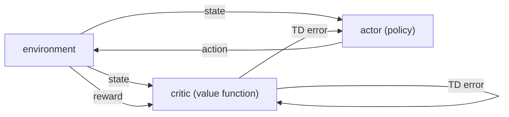

# Policy approximation: actor-critic and average reward (Sutton & Barto, Chapter 11)

> [!abstract] TL;DR
> Actor-critic methods store the policy separately (the actor) from the value function (the critic), and a single temporal-difference (TD) error from the critic drives learning in both; eligibility traces extend them. The chapter also replaces discounting with the average-reward setting, where values are measured relative to the long-run reward per step, and gives R-learning, an off-policy control method for it.

## Problem

- **Action-value methods select actions through values**: all earlier control methods (Sarsa, Q-learning) learn $q$ values and derive the policy from them, for example $\varepsilon$-greedy; see [[06 Temporal-difference learning]]. Here the policy gets its own parameters, independent of any value function, and values may be learned but are not used to pick actions directly.
- **Choosing an action from values can be expensive**: with infinitely many actions, such as a continuous-valued action, a values-only method must search that whole set at every step.
- **Discounting does not fit an approximated policy**: the chapter states that one generally has to abandon the discounted-reward setting once the policy is approximated, and replaces it with the average-reward setting (defined below).

## Examples in the chapter

| Example | Setting / decision | What it demonstrates |
|---------|--------------------|----------------------|
| Access-control queuing | accept or reject the customer at the head of a queue for $n$ servers, customers of four priorities pay 1, 2, 4 or 8 | R-learning finds a sensible accept/reject policy for an undiscounted, continuing task with unknown arrival and departure statistics |

- **What the result shows**: the learned policy accepts higher-priority customers with fewer free servers than lower-priority ones, and the learned average reward $\bar R$ is about 2.73 per step. Values for states with many free servers fall off, which the book probably attributes to insufficient data, since many of those states were never experienced.
- **Setup**: $n = 10$ servers, a share $h = 0.5$ of high-priority customers, each busy server freeing with probability $p = 0.06$ per step, run for 2 million steps.

## Conceptual framework

- **Action-value method**: any method that derives its policy from learned action values; the chapter's methods are not of this kind.
- **Actor**: the separate memory structure that represents the policy and selects actions.
- **Critic**: the estimated value function, usually a state-value function; it "criticizes" the actor's actions by evaluating how the new state compares with what was expected. See [[03b MDPs, value functions, optimality]] for $v_\pi$.
- **TD error as the only signal**: one scalar from the critic drives all learning, in both critic and actor; the state feeds both critic and actor, the reward feeds the critic, and the actor's action goes out to the environment.
- **Eligibility trace**: a decaying record of which quantities were recently visited, so that one TD error is spread over them; defined in [[07a n-step TD and TD(λ)]].
- **On-policy learning**: the critic must learn about, and critique, whichever policy the actor currently follows.
- **Link to the gradient bandit**: actor-critic is the natural extension of the preference-based gradient bandit in [[02 Multi-armed bandits]] to TD learning and the full RL problem. There a reward minus a baseline raised or lowered the chosen action's preference; here the TD error plays that role and preferences are kept per state.
- **Average-reward setting**: no discounting and no episodes; one maximizes the average reward per time step. It assumes the process is ergodic, meaning every state can be reached from every other with nonzero probability under any policy, so the average reward does not depend on the starting state. Continuing tasks are introduced in [[03a MDP setting and returns]].
- **Relative value**: because long-run reward per step is the same from any state, value measures only the transient, the stretch of better- or worse-than-average rewards received from a given start.
- **R-learning**: an off-policy control method for this setting. As in Q-learning ([[06 Temporal-difference learning]]), a behavior policy generates experience (for instance $\varepsilon$-greedy in $Q$) and the estimation policy being improved is typically the greedy policy with respect to $Q$.

## Approach

### One-step actor-critic

1. **Critic**: after each action, compute the TD error from the new state's value; positive means things went better than expected, negative worse.
2. **Actor**: raise the preference for the action just taken if the TD error is positive, lower it if negative. With a Gibbs softmax policy (probabilities proportional to $e^{H}$ of per-state preferences $H$), this is a direct additive change to one preference.
3. **Variations the chapter names**:
   - Select actions in other ways.
   - Use eligibility traces (next subsection).
   - Scale the credit given to the taken action by a factor inversely related to its probability, the "one minus probability" factor.
4. **Claimed advantages**:
   - Cheap action selection, since the policy is stored explicitly (it matters most when actions are infinite in number).
   - They can learn an explicitly stochastic policy, with the optimal action probabilities, which is useful in competitive and non-Markov cases.
   - The separate actor makes domain-specific constraints on allowed policies easier to impose, and makes them more appealing as psychological and biological models.
5. **Intermediate architectures**: one could learn both an action-value function and an independent policy.

### Eligibility traces for actor-critic

- **Critic**: on-policy learning of $v_\pi$ with TD($\lambda$), one trace per state; see [[07a n-step TD and TD(λ)]].
- **Actor**: one trace per state-action pair, because the preferences live on pairs. An actor-critic method with traces therefore keeps two sets of traces.
- **Simplest case** (the preference update $+\alpha\delta_t$): the pair trace is updated as in Sarsa($\lambda$); see [[07b Eligibility-trace control and off-policy]].
- **"One minus probability" case**: the same update applies with a changed trace, which is incremented by $1 - \pi_t(A_t \mid S_t)$ instead of by 1 when the pair occurs.

### R-learning

1. **State**: keep an action-value function $Q$ and a scalar estimate $\bar R$ of the average reward.
2. **Step**: act with the behavior policy, observe $R$ and $S'$, and form a TD error with $\bar R$ subtracted from the reward and no discount.
3. **Update $Q$** of the pair just taken by $\alpha\delta$.
4. **Update $\bar R$** by $\beta\delta$, but only when the action taken was greedy in $Q$.
5. **What converges to what**: with $\pi$ the estimation policy, $Q$ approximates $q_\pi$ (the relative action values) and $\bar R$ approximates $\bar r(\pi)$.

## Math

**Notation.**

| Symbol | Meaning |
|--------|---------|
| $S_t, A_t, R_t$ | state, action and reward, as in [[03a MDP setting and returns]]; the reward after $A_t$ is $R_{t+1}$ |
| $\gamma$ | discount rate; used by the critic in the actor-critic equations, absent from the average-reward setting |
| $\delta_t$ | TD error of the critic at time $t$ |
| $V_t$ | critic's state-value estimate at time $t$ |
| $H_t(s,a)$ | actor's preference for action $a$ in state $s$ at time $t$ |
| $\pi_t(a \mid s)$ | probability of $a$ in $s$ under the actor's softmax policy at time $t$ |
| $\beta$ | actor step size in the one-step method; in R-learning, step size of the $\bar R$ update |
| $\alpha$ | actor step size in the trace version, as the chapter writes it; in R-learning, step size of the $Q$ update |
| $E_t(s,a)$ | eligibility trace of the pair $(s,a)$ |
| $\lambda$ | trace decay rate |
| $\bar r(\pi)$ | average reward per step under policy $\pi$ |
| $\bar R$ | estimate of $\bar r(\pi)$ kept by R-learning |
| $v_\pi(s), q_\pi(s,a)$ | relative values: expected sum of future rewards minus $\bar r(\pi)$ per step |
| $Q(s,a)$ | R-learning's action-value estimate |

**Critic's TD error:**

$$
\delta_t = R_{t+1} + \gamma V_t(S_{t+1}) - V_t(S_t)
$$

- It is the one-step TD error of the current critic (as in [[07a n-step TD and TD(λ)]]). It is positive when the transition went better than $V$ predicted.

**Gibbs softmax policy of the actor:**

$$
\pi_t(a \mid s) = \Pr\{A_t = a \mid S_t = s\} = \frac{e^{H_t(s,a)}}{\sum_b e^{H_t(s,b)}}
$$

- Preferences are the actor's modifiable parameters; only differences between them matter, as in the gradient bandit.

**One-step preference update:**

$$
H_{t+1}(S_t, A_t) = H_t(S_t, A_t) + \beta \delta_t
$$

- Only the preference of the pair just visited changes; positive $\delta_t$ strengthens $A_t$ in $S_t$.

**Preference update with the inverse-probability factor:**

$$
H_{t+1}(S_t, A_t) = H_t(S_t, A_t) + \beta \delta_t \big[ 1 - \pi_t(A_t \mid S_t) \big]
$$

- The credit shrinks as $A_t$ becomes more likely, and it matches the factor $1 - \pi_t(A_t)$ in the gradient bandit's update for the chosen action.

**Trace-based actor update:**

$$
H_{t+1}(s,a) = H_t(s,a) + \alpha \delta_t E_t(s,a)
$$

- Applied to all state-action pairs; $\delta_t$ is the one-step TD error (the TD($\lambda$) error of the critic). With $\lambda = 0$ and a trace incremented by 1, it reduces to the one-step update.

**Trace for the inverse-probability variant:**

$$
E_t(s,a) =
\begin{cases}
\gamma\lambda E_{t-1}(s,a) + 1 - \pi_t(A_t \mid S_t) & \text{if } s = S_t \text{ and } a = A_t, \\
\gamma\lambda E_{t-1}(s,a) & \text{otherwise,}
\end{cases}
\qquad \text{for all } s, a
$$

- Every trace decays by $\gamma\lambda$ each step; the pair just taken is incremented by $1 - \pi_t(A_t \mid S_t)$ rather than by 1.

**Average reward per step:**

$$
\bar r(\pi) = \lim_{n \to \infty} \frac{1}{n} \sum_{t=1}^{n} \mathbb{E}_\pi [R_t]
$$

- Well defined, and independent of the starting state, if the process is ergodic.

**Relative state value and action value:**

$$
v_\pi(s) = \sum_{k=1}^{\infty} \mathbb{E}_\pi \big[ R_{t+k} - \bar r(\pi) \mid S_t = s \big], \qquad
q_\pi(s,a) = \sum_{k=1}^{\infty} \mathbb{E}_\pi \big[ R_{t+k} - \bar r(\pi) \mid S_t = s, A_t = a \big]
$$

- Each reward is measured against the policy's average reward, so the sum is the transient advantage of starting from $s$ (or taking $a$ in $s$) over the long-run rate.
- For most practical purposes policies are ordered by $\bar r(\pi)$ alone, and all policies attaining the maximal $\bar r(\pi)$ are called optimal; the book notes that subtler optimality distinctions exist in the undiscounted continuing case.

**R-learning update (one step):**

$$
\begin{aligned}
\delta &\leftarrow R - \bar R + \max_a Q(S', a) - Q(S, A) \\
Q(S, A) &\leftarrow Q(S, A) + \alpha \delta \\
\bar R &\leftarrow \bar R + \beta \delta \quad \text{only if } Q(S, A) = \max_a Q(S, a)
\end{aligned}
$$

- It is the Q-learning update with the discount replaced by subtracting $\bar R$ from each reward. $\bar R$ and $Q$ are initialized arbitrarily, and the loop runs forever, since there are no episodes. In the example, $Q$ and $\bar R$ start at zero, $\alpha = \beta = 0.01$ and $\varepsilon = 0.1$.
- The condition on $\bar R$ is checked after the $Q$ update, as the algorithm is printed.

> [!example] Worked intuition
> Formalized here with illustrative numbers; the book gives only the algorithm. Take $\bar R = 2$, $Q(S,A) = 1$, $R = 4$, $\max_a Q(S',a) = 3$, $\alpha = \beta = 0.01$. Then $\delta = 4 - 2 + 3 - 1 = 4$ and $Q(S,A) \leftarrow 1 + 0.01 \cdot 4 = 1.04$. If $A$ was also the greedy action, $\bar R \leftarrow 2 + 0.01 \cdot 4 = 2.04$; if $A$ was exploratory, $\bar R$ stays 2.

## Dataset example

One row per time step of an actor-critic run with a tabular critic and softmax actor; illustrative rows (the chapter prints no data). Here $\gamma = 0.9$, $\beta = 0.1$, and a terminal next state has $V = 0$ (the usual episodic convention, not stated in this chapter). The last two columns are hand-checked: $\delta_t = R_{t+1} + \gamma V_t(S_{t+1}) - V_t(S_t)$, then the change to $H_t(S_t, A_t)$ is $\beta\delta_t$ for the plain update and $\beta\delta_t[1 - \pi_t(A_t \mid S_t)]$ for the inverse-probability variant.

| $t$ | $S_t$ | $A_t$ | $R_{t+1}$ | $V_t(S_t)$ | $V_t(S_{t+1})$ | $\pi_t(A_t \mid S_t)$ | $\delta_t$ | change in $H$, plain | change in $H$, with $1-\pi$ |
|-----|-------|-------|-----------|------------|----------------|------------------------|-----------|-----------------------|------------------------------|
| 0 | $s_1$ | right | 1 | 0.5 | 0.8 | 0.5 | 1.22 | +0.122 | +0.061 |
| 1 | $s_2$ | left | 0 | 0.8 | 0.4 | 0.25 | -0.44 | -0.044 | -0.033 |
| 2 | $s_3$ | right | 1 | 0.4 | 0 (terminal) | 0.8 | 0.6 | +0.06 | +0.012 |

- **Column to symbol**: each column is the symbol in its header; $V_t(S_t)$ and $V_t(S_{t+1})$ are read from the critic's table, and $\pi_t(A_t \mid S_t)$ from the softmax over the actor's preferences.
- **What is derived**: the TD error from the critic's table, then one preference change for the visited pair; the same $\delta_t$ would also update the critic's own table, which the chapter does not write out for the one-step method.
- **Absent**: the actor's full preference table and the critic's step size, which the rows do not need.

## Where it matters in practice

### Signs a problem fits

- **Actor-critic**: the situations behind its listed advantages, namely a continuous or very large action set, a good policy that is itself stochastic, or constraints on allowed policies.
- **Average-reward setting and R-learning**: the task never ends, rewards are not naturally discounted, and the quantity of interest is reward per step, as in the queuing task.

### What you need to use it

- **Actor-critic**: online experience (the critic learns on-policy), a critic value function, a policy with its own parameters, and two step sizes (actor and critic); with traces, one trace per state and one per state-action pair.
- **R-learning**: a continuing task whose process can be assumed ergodic, a behavior policy that keeps exploring, and two step sizes ($\alpha$ for $Q$, $\beta$ for $\bar R$).

### When not to trust it

- **Rarely visited states**: learned values there are unreliable, as the queuing result shows.
- **Non-ergodic processes**: if some states cannot be reached from others, $\bar r(\pi)$ may depend on the start, and the relative values are no longer well defined.

## Assumptions & limitations

- **The actor here is a table of preferences**: the chapter's own opening says the policy gets its own weights, but the algorithms given are tabular (a preference per state-action pair); policies parameterized by function approximation and gradient methods on them are not developed.
- **Actor-critic is lightly treated**: the chapter says the variations on the credit-assignment factor were explored mainly for the immediate-reward case and have not been fully brought up to date; no convergence or performance result is given.
- **Average-reward optimality is loosely defined**: ordering policies by $\bar r(\pi)$ ignores subtler optimality distinctions in the undiscounted continuing case.
- **R-learning is demonstrated by one task**: the queuing example, with no comparison against other methods and no convergence argument.
- **An exercise is left open**: design an on-policy method for undiscounted, continuing tasks.
