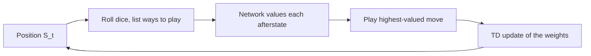

# TD-Gammon (Sutton & Barto, Chapter 14, case study 1)

> [!abstract] TL;DR
> TD-Gammon learns to play backgammon by combining temporal-difference (TD) learning with a multilayer neural network that outputs the probability of winning, trained purely on games the program plays against itself. With almost no backgammon knowledge it matched the best earlier programs after about 300,000 games, and the draft judges its latest version, with added features and lookahead search, to be at or near the level of the best human players.

Sibling case studies: [[14.2 Samuel's checkers player]], [[14.3 The Acrobot]], [[14.4 Elevator dispatching]], [[14.5 Dynamic channel allocation]] and [[14.6 Job-shop scheduling]].

## Problem

- **Game**: two players each have 15 pieces on a board of 24 locations called points. Each turn the mover rolls two dice and moves pieces by the two numbers shown, and the first to bring all pieces off the board wins. Pieces interact: a single piece alone on a point can be "hit" and sent back to start (the "bar"), while two or more pieces on a point are protected from the opponent.
- **Too many positions**: with 30 pieces on 24 locations (26 counting the bar and the off-board area) the number of positions exceeds any possible memory and a lookup table of values cannot be used.
- **Too much branching for search**: a typical dice roll allows about 20 ways to play, and looking one move ahead also needs the opponent's dice rolls, so the game tree has an effective branching factor of about 400. This is too large for the conventional heuristic search that works well in chess and checkers.
- **Theory does not apply**: the theoretical results of the earlier chapters cannot be usefully applied to this task, for two reasons: the number of states (above), and the opponent is a source of uncertainty and of change over time.
- **What fits TD learning**: the game is highly stochastic, yet the complete state (the position) is visible at all times, and each game ends in a win or a loss that can be read as a final reward to predict.

## Conceptual framework

- **Value as winning probability**: the estimated value $\hat v(s)$ of a board position $s$ is meant to estimate the probability of winning from it. Rewards are zero at every step except the steps on which the game is won; the book does not state the size of that positive reward, but with reward 1 the return is the win indicator (derived here; return and value are defined in [[03a MDP setting and returns]] and [[03b MDPs, value functions, optimality]]).
- **Self-play**: the learner plays both sides. Each game is one episode (a run from the first position to the end of the game) and the positions that occur are its states $S_0, S_1, S_2, \dots$, so the program generates unlimited training experience by itself.
- **Afterstate**: the position right after the mover's own move, before the opponent's roll and reply; its definition and why it suits games are in [[06 Temporal-difference learning]]. The program values the afterstates of its candidate moves.
- **Nonlinear TD($\lambda$)**: the gradient-descent TD($\lambda$) algorithm with a nonlinear function approximator (a neural network) in place of a linear one; the algorithm and its traces are in [[09a Function approximation and linear methods]] and [[07a n-step TD and TD(λ)]].
- **Backpropagation**: the procedure that computes the gradient of the network output with respect to every weight efficiently.
- **Decide-time search**: lookahead performed at the moment of choosing a move, with the learned value function scoring the leaves; the general idea is in [[08b Trajectory sampling, search, MCTS]].

## Approach

1. **Network**: a standard network with a layer of input units, one layer of hidden units and a single output unit. The versions used 40 or 80 hidden units in the results table, but the text gives 160 for version 3.0 where the table gives 80.
   - The input is a representation of one position and the output is $\hat v$ of that position.
   - The real network had two extra output units that estimate the probability of each player's winning in a special way called a "gammon" or "backgammon".
   - The weights start as small random values.
2. **Input encoding of the first version (TD-Gammon 0.0)**: 198 units, one for each conceptually distinct possibility that seemed relevant, scaled to roughly the range 0 to 1, with little effort to minimize the number of units.
   - **Per point**: four units for white pieces and four for black, giving 192 units. Unit 1 turns on with one piece, unit 2 also with two, unit 3 also with three; with $n > 3$ pieces unit 4 takes the value $(n-3)/2$.
   - **Bar**: one unit per colour, each with value $n/2$ for $n$ pieces on the bar.
   - **Borne off**: one unit per colour, each with value $n/15$ for $n$ pieces already removed from the board.
   - **Turn**: two binary units say whether it is white's or black's turn.
3. **Move selection**: for the dice roll, take each of the 20 or so legal ways to play, form the resulting afterstate, have the network estimate its value, and play the move leading to the highest estimate.
4. **Learning**: apply the TD($\lambda$) update fully incrementally, after every move, using the network's own estimate of the next position as the target.
5. **Training course**: the initial evaluations are arbitrary, so early moves are poor and games often last hundreds or thousands of moves before one side wins almost by accident. After a few dozen games performance improves rapidly.
6. **Later versions**: adding specialized backgammon features to the input while keeping self-play TD learning gave TD-Gammon 1.0. Versions 2.0 and 2.1 added a selective two-ply search, and the draft describes 3.0 as the most recent version, with a selective three-ply search.
   - **Two-ply search** (a ply is one player's move): besides the positions resulting from each candidate move, it considers the opponent's possible dice rolls and replies, assuming the opponent always plays the move that looks immediately best for him, and picks the candidate with the best expected value.
   - **Selectivity**: the second ply is searched only for candidates ranked highly after the first ply, about four or five on average, to save computer time.
   - Search affects only which moves are played; the learning process is unchanged.

### Results

| Program | Training games | Opponents | Net points over games |
|---------|----------------|-----------|-----------------------|
| TD-Gammon 0.0 | 300,000 | other programs | tied for best |
| TD-Gammon 1.0 | 300,000 | Robertie, Magriel and others | $-13$ in 51 |
| TD-Gammon 2.0 | 800,000 | various grandmasters | $-7$ in 38 |
| TD-Gammon 2.1 | 1,500,000 | Robertie | $-1$ in 40 |
| TD-Gammon 3.0 | 1,500,000 | Kazaros (a different player) | $+6$ in 20 |

- **Reading the points**: the book does not define the unit; read as net points against the listed human opponents (negative means the program was behind), the programs go from behind the human players toward and then past parity.
- **Versus a knowledge-heavy rival**: the draft calls Neurogammon arguably the reigning champion program of the time; it trained its network on a large corpus of expert moves and started from specially crafted features. The first version, with essentially zero backgammon knowledge, matched it.
- **Draft's judgement**: version 3.0 appears to be at or very near the strength of the best human players.
- **Draft's report on play**: the programs changed how top humans play certain opening positions.

## Math

**Notation.** The symbols are those of [[09a Function approximation and linear methods]]; the neural network is the particular form of $\hat v$.

| Symbol | Meaning |
|--------|---------|
| $S_t$ | position (state) at time $t$ in a self-play game |
| $R_{t+1}$ | reward received after the move |
| $\hat v(s, \mathbf{w})$ | network output, the estimated probability of winning from position $s$ |
| $\mathbf{w}_t$ | vector of all network weights at time $t$ |
| $\mathbf{e}_t$ | eligibility-trace vector, one component per weight, $\mathbf{e}_0 = \mathbf{0}$ |
| $v_\pi$ | value function of the self-play policy $\pi$ that $\hat v$ approximates (derived here; the book does not name it) |
| $\alpha$, $\gamma$, $\lambda$ | step size, discount rate (here $\gamma = 1$), trace-decay parameter |
| $x_i$, $w_{ij}$ | value of input unit $i$; weight of its connection to hidden unit $j$ |
| $h(j)$, $\sigma$ | output of hidden unit $j$; the sigmoid function |

**Hidden unit.** Each hidden unit sums its weighted inputs and passes the sum through a sigmoid:

$$
h(j) = \sigma\Big(\sum_i w_{ij} x_i\Big) = \frac{1}{1 + e^{-\sum_i w_{ij} x_i}}
$$

- The sigmoid output always lies between 0 and 1 and reads naturally as a probability built from a summation of evidence. The output unit works the same way on the hidden-unit outputs, with its own weights, so $\hat v \in (0,1)$.

**TD($\lambda$) weight update:**

$$
\mathbf{w}_{t+1} = \mathbf{w}_t + \alpha \Big[ R_{t+1} + \gamma \hat v(S_{t+1}, \mathbf{w}_t) - \hat v(S_t, \mathbf{w}_t) \Big] \mathbf{e}_t
$$

**Eligibility trace:**

$$
\mathbf{e}_t = \gamma \lambda \mathbf{e}_{t-1} + \nabla \hat v(S_t, \mathbf{w}_t), \qquad \mathbf{e}_0 = \mathbf{0}
$$

- The update moves the weights so that the value of $S_t$ moves toward the reward plus the estimated value of the successor; it targets $v_\pi$ for the current self-play policy $\pi$.
- With $\gamma = 1$ and zero reward except on winning, the bracket (the TD error) is usually just $\hat v(S_{t+1}, \mathbf{w}) - \hat v(S_t, \mathbf{w})$: the change in estimated win probability from one position to the next.
- In words (derived here): the trace spreads each error over the weights that recently influenced the estimate; the gradient $\nabla \hat v$ (derivative of the output with respect to the weights) comes from backpropagation.

> [!example] Worked intuition
> Formalized here, with invented numbers: if the network says 0.60 for $S_t$ and 0.70 for $S_{t+1}$, the error is $0.70 - 0.60 = 0.10 > 0$, so the weights move to raise $\hat v(S_t)$ toward 0.70 (exactly the gradient direction only for the first step or $\lambda = 0$; otherwise the direction is the trace, accumulated gradients). If it said 0.50 for $S_{t+1}$, the error is $-0.10$ and the estimate for $S_t$ is lowered.

## Dataset example

One input vector per position (198 numbers); illustrative values, not printed in the book. The table applies the encoding rules above to made-up counts of white pieces; black units follow the same rule.

| Quantity | Pieces $n$ | Units (1 to 4, or the single unit) |
|----------|-----------|------------------------------------|
| White on a point | 0 | 0, 0, 0, 0 |
| White on a point | 1 | 1, 0, 0, 0 |
| White on a point | 2 | 1, 1, 0, 0 |
| White on a point | 3 | 1, 1, 1, 0 |
| White on a point | 4 | 1, 1, 1, 0.5 (fourth unit is $(4-3)/2$; it keeps growing with more pieces) |
| White on the bar | 2 | $2/2 = 1$ |
| White borne off | 6 | $6/15 = 0.4$ |

- Column mapping: each row's units are inputs $x_i$ of $\hat v(S_t, \mathbf{w})$. A full vector has the 198 units listed under Approach.
- Derived from the input: the hidden outputs $h(j)$ and the single output $\hat v$; the training signal is the difference of two successive outputs.
- Absent: the opponent's strategy, move history and any hand-made backgammon feature (these appear only in later versions).

## Where it matters in practice

### Signs a problem fits

- A stochastic sequential game with a visible state and a final win or loss to predict, where lookahead search is too costly and a table is out of the question.

### What you need to use it

- A fast source of complete episodes (self-play), a representation of the state that a network can use, and compute for hundreds of thousands to millions of games.

## Assumptions & limitations

- **Representation matters**: the first version needed little backgammon knowledge but much knowledge of how neural networks work and how to present information to them; the encoding was chosen by hand.
- **No theoretical guarantee**: because the earlier theory cannot be usefully applied (reasons under Problem), the success rests on the playing results above.
