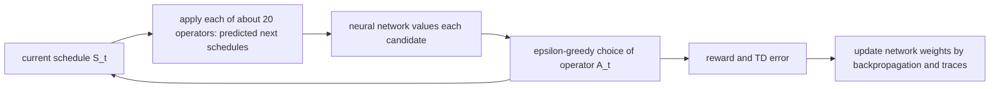

# Job-shop scheduling (Sutton & Barto, Chapter 14 case study)

> [!abstract] TL;DR
> A temporal-difference (TD) learner with a neural-network value function was trained to guide a search that repairs a schedule step by step, so that it finds conflict-free schedules of short duration for a whole class of scheduling problems, not for one instance. Trained networks needed many fewer repairs than the hand-built repair algorithms to reach schedules of the same quality, and the simpler of the two network designs also gave the best trade-off between computer time and quality.

## Problem

- **Task**: complete a collection of tasks under temporal constraints (some tasks must finish before others start) and resource constraints (two tasks needing the same resource cannot run at once). The output is a schedule: a start time and the resources for every task, with no constraint violated and the shortest total duration possible. This is the job-shop scheduling problem.
- **Hardness**: in general it is NP-complete, meaning there is probably no efficient way to find the shortest schedule for arbitrary instances. In practice it is solved with heuristic algorithms tuned to each kind of instance, and designing them is costly and slow.
- **Domain studied**: scheduling the installation and testing of cargo-bay payloads for space shuttle missions (the NASA space shuttle payload processing problem, SSPP). One instance covers two to six missions with 34 to 164 tasks each.
  - A task has a duration and a list of resources; for instance, one task lasts 7200 time units and needs two quality control officers, two technicians and three other named resources.
  - Resources come in pools, and when a task needs several resources of one type they must all come from the same pool, the right one (for example officers of the same shift and site).
- **Why it is hard to learn**: a conflict-free schedule is easy to find; a short conflict-free one is not. Treating each whole schedule as an action of a bandit (see [[02 Multi-armed bandits]]) gives astronomically many actions and yields one schedule for one instance, with nothing reusable.
- **Goal**: learn a skill for the domain, a policy that quickly finds good schedules for any instance of the problem, and thereby reduce hand engineering.

## Conceptual framework

- **Iterative repair**: a local search (hill climbing: generate schedules one after another, each meant to beat the last in violations and duration) that starts from a critical path schedule, one meeting the temporal constraints but ignoring the resource constraints, and repairs resource conflicts step by step.
  - The critical path schedule places each task before launch as late as the temporal constraints allow and each task after landing as early as they allow; resource pools are assigned at random.
- **Repair operators**, each applicable to a task that violates a resource constraint:
  - **Reassign-Pool** changes the pool assigned to one of the task's resources, only if the change satisfies the requirement.
  - **Move** shifts the task to the first earlier or later time at which its resource needs can be met, then reschedules all its temporal dependents (tasks that must start after it) by the critical path method.
- **Baseline step selection**: take the earliest task with a violation; use a Reassign-Pool operator if any applies (random among several), otherwise a random Move operator, favoring short moves of tasks with few temporal dependents whose needs are close to the task's overallocation (the excess of its resource demand over what is available).
- **Simulated annealing acceptance**: accept a repaired schedule with probability $\exp(-\Delta V / T)$, where $\Delta V$ is the number of violations the repair removed and $T$ is a temperature lowered gradually; a rejected repair is retried from the old schedule. The search stops when no constraint is violated, and the algorithm is run several times, keeping the shortest conflict-free schedule.
- **Plan space**: a search space whose states are complete plans (here schedules) and whose actions are plan modifications, a more abstract setting for reinforcement learning (RL) than earlier chapters.
- **Resource dilation factor (RDF)**: a measure of a schedule's duration made comparable across instances by using the resource overallocation of the starting schedule to account for instance difficulty; longer schedules tend to have larger RDF. The book does not print the formula.
- **Reused ideas**: a value function approximated by a neural network ([[09a Function approximation and linear methods]], [[09b Control with approximation, bootstrapping]]), trained with TD($\lambda$) and eligibility traces ([[06 Temporal-difference learning]], [[07a n-step TD and TD(λ)]]), and used for lookahead action selection ([[08b Trajectory sampling, search, MCTS]]).

## Approach

### The RL formulation

1. **State**: an entire schedule; the initial state $S_0$ is the critical path schedule the baseline also starts from.
2. **Actions**: the applicable Reassign-Pool and Move operators, typically about 20 per state.
3. **Episodes**: each starts at $S_0$ and ends at a schedule violating no constraint.
4. **Reward**: $-0.001$ for each step whose schedule still violates a constraint (pushes toward few repairs), and at the end of the episode the negative RDF of the final schedule (pushes toward short schedules).
5. **Trade-off**: the return from a schedule needing $N$ repairs to reach the final conflict-free schedule $S_f$ is given in Math. One repair is worth 0.001 of RDF, so an optimal policy takes an extra repair only if it promises to lower the final RDF by more than that. The system has one goal, expected return; the reward values alone set the trade-off between the two aims.
6. **Learning**: TD($\lambda$) with a multilayer neural network value function trained by backpropagating TD errors (backpropagation computes the gradient of the error with respect to the weights).
7. **Acting**: $\varepsilon$-greedy with $\varepsilon$ decreasing during learning (see [[05a Monte Carlo prediction and control]]). The greedy action comes from one-step lookahead: the schedule each operator would produce is easy to predict, so the network values every candidate and the best is chosen.

### Modifications to the basic procedure

- **Backward TD($\lambda$) after each episode**, with the trace running over future rather than past states, which seemed more accurate and efficient than forward learning.
- **Multiple weight updates when the TD error is large**, apparently equivalent to an error-dependent step size.
- **Experience replay**: after every four episodes, relearn from the best episode so far as if new; early training also learns from episodes of a good scheduler, replayable later.
- **Random sample greedy search**: for large problems, estimate the greedy action from random samples of actions, enlarging the sample until a preset confidence is reached that the sample's best is the true greedy action.
- **Loop check**: excessive looping slowed learning considerably, so the system detects loops and alters action selections.
- How much each modification mattered is not established.

### Two network designs

1. **Non-TDNN network (G12N)**: 20 handcrafted features, found by studying small problems for predictors of RDF.
   - Only four resource pools tended to cause allocation problems; the mean and standard deviation of each pool's unused portion over the schedule give 10 real-valued features. Two more are the schedule's RDF and the percentage of its duration with resource violations.
   - Network: 20 inputs, 40 sigmoidal hidden units (each outputs a smooth squashed function of its weighted inputs), 8 sigmoidal outputs. The outputs code the value so that, roughly, the location of the activity peak over the 8 units represents it.
2. **Time-delay neural network (TDNN, G12TDN)**, borrowed from speech recognition: a schedule is split into blocks (maximal intervals in which tasks and resource assignments do not change), each described by features like those above.
   - "Kernel" networks scanned across the blocks make more abstract features; a layer then averages them over each third of the blocks, since schedules differ in block count. The same 8-unit output code follows; 1123 adjustable weights in all.

### Training and results

- **Data**: 100 artificial scheduling problems, split into training, validation (to decide when to stop) and final test sets. Validation was checked every 100 episodes and training stopped when it stopped changing, generally after about 10,000 episodes.
- **Networks**: $\lambda \in \{0.2, 0.7\}$, three training sets, and two saved weight sets each (final, and best on validation) give 12 networks, each a different scheduling algorithm; G12TDN is the mean of the 12.
- **Baselines**: iterative repair with annealing on the number of violations (IR-V) and on RDF (IR-RDF).
- **Metric**: mean RDF of the best schedule found by running an algorithm repeatedly, against total repairs and against computer time.
- **Repairs needed**: G12TDN and G12N reach a given RDF with many fewer accepted repairs than IR-V and IR-RDF. Read off the plot (approximate): the learned ones reach RDF near 1.2 within roughly 20,000 accepted repairs, IR-RDF is still at about 1.21 at its last plotted point near 150,000 repairs, and IR-V is still above 1.23 at its last plotted point.
- **Computer time**: G12N gives the best trade-off between time and quality; G12TDN loses to the time its kernel scanning takes, which the authors say could be sped up in many ways.

## Math

**Notation.** Time-step symbols match earlier notes; the book gives no discount rate for this task.

| Symbol | Meaning |
|--------|---------|
| $S_t$, $A_t$, $R_{t+1}$ | the schedule (state), the repair operator applied (action) and the reward received after it |
| $S_0$, $S_f$ | the initial critical path schedule and the final conflict-free schedule |
| $N$ | number of repairs from a given schedule to $S_f$ |
| $RDF(\cdot)$ | resource dilation factor of a schedule |
| $\hat v(s, \mathbf{w})$ | network's approximate value of schedule $s$ under weights $\mathbf{w}$ (notation of [[09a Function approximation and linear methods]]) |
| $\delta_t$ | TD error |
| $\mathbf{e}_t$ | eligibility-trace vector, one component per weight |
| $\alpha$, $\lambda$, $\varepsilon$ | step size, trace decay, exploration probability |
| $\Delta V$, $T$ | constraint violations removed by a repair, and the annealing temperature (baseline algorithm only) |

**Return from a schedule:**

$$
G = -RDF(S_f) - 0.001\,(N-1)
$$

- The last repair yields the reward $-RDF(S_f)$ instead of the step cost. No discounting appears, so the rewards are summed directly (formalized here: this corresponds to $\gamma = 1$).

**TD error with an approximate value (formalized here from the notation of earlier notes; the book names the method, not the formula):**

$$
\delta_t = R_{t+1} + \hat v(S_{t+1}, \mathbf{w}_t) - \hat v(S_t, \mathbf{w}_t)
$$

- Estimates how far the network's value of $S_t$ is from reward plus the value of the repaired schedule; $\hat v$ of the final schedule is 0.

**TD($\lambda$) weight update (backward view, as in [[09b Control with approximation, bootstrapping]]):**

$$
\mathbf{w}_{t+1} = \mathbf{w}_t + \alpha\,\delta_t\,\mathbf{e}_t, \qquad \mathbf{e}_t = \gamma\lambda\,\mathbf{e}_{t-1} + \nabla \hat v(S_t, \mathbf{w}_t)
$$

- The book applies this variant after each episode with the trace running over future states, and sometimes repeats the weight update when $\delta_t$ is large; the exact form is not printed, so this is the standard TD($\lambda$) update, not a transcription.

> [!example] Worked intuition
> Formalized here with illustrative numbers. From some schedule, one repair reaches a conflict-free schedule of RDF 1.30, return $-1.30$. Two repairs ending at the same RDF return $-1.301$, so the quicker route wins. Two repairs ending at RDF 1.25 return $-1.251$ and beat both, because 0.05 of RDF saved outweighs 0.001 for the extra repair.

## Dataset example

One row per repair step of one episode; illustrative values (the book prints no episode). Each row is one decision: the learned $\hat v$ scores the candidate schedules, the best is applied, and a TD error follows. The two feature columns are two of the 20 features of the non-TDNN network; the book names these two but not the other eight beyond the ten pool statistics.

| $t$ | $S_t$ | RDF($S_t$) | % duration violating | $\hat v(S_t)$ | $A_t$ | $R_{t+1}$ | $\hat v(S_{t+1})$ | $\delta_t$ |
|-----|-------|------------|----------------------|---------------|-------|-----------|-------------------|------------|
| 0 | critical path $S_0$ | 1.45 | 31 | $-1.36$ | Reassign-Pool, task 12 | $-0.001$ | $-1.34$ | 0.019 |
| 1 | $S_1$ | 1.43 | 22 | $-1.34$ | Move, task 31 | $-0.001$ | $-1.30$ | 0.039 |
| 2 | $S_2$ | 1.40 | 9 | $-1.30$ | Move, task 7 | $-0.001$ | $-1.27$ | 0.029 |
| 3 | $S_3$ | 1.38 | 3 | $-1.27$ | Reassign-Pool, task 40 | $-1.24$ | 0 (terminal) | 0.030 |

- **Check**: the final step reaches a conflict-free $S_f$ with $RDF(S_f) = 1.24$, so $R_4 = -1.24$; the return from $S_0$ is $-1.24 - 0.001 \cdot 3 = -1.243$, and the four TD errors use $\gamma = 1$ as in Math.
- **Column to symbol**: $A_t$ is the greedy operator among about 20 candidates at that step; $\hat v(S_{t+1})$ is the value of the schedule the chosen operator produces. The network consumes the 20 features, not the schedule itself, and its output is the 8-unit code read as a value.
- **Absent**: the annealing test (the learned procedure replaces the baseline's operator choice, and the book does not say whether annealing acceptance is kept), and the other eight features.

## Where it matters in practice

### Signs a problem fits

- A family of related combinatorial problems solved again and again, where a hand-built heuristic is costly to design and a policy that finds good solutions quickly is worth learning.
- Solutions improve by local modifications whose result can be predicted, so candidates can be scored before acting.

### What you need to use it

- **Instances**: many problem instances for training, validation and testing (here 100 artificial ones, about 10,000 episodes per network).
- **Features or a structured network** that can predict solution quality, found by studying small problems.
- **A reward that mixes the aims**: a per-step cost for effort and a terminal reward for quality that is comparable across instances (the role of RDF).

### When not to trust it

- **Measure the right cost**: fewer repairs need not mean less computer time, because evaluating a richer network at every candidate can cost more than it saves.

## Assumptions & limitations

- **Instances resemble training instances**: the learned skill is for one domain (here shuttle payload scheduling, tested on artificial problems), not for arbitrary scheduling.
- **Known effects of actions**: the method relies on predicting the schedule each operator produces; without that, the lookahead is not available.
- **Hand engineering remains**: features, reward values, network structure and the many training tweaks were developed by trial and error.
- **No unequivocal proof**: the evidence supports, but does not establish, that RL improves search for hard problems.
- **Early-stage evidence**: plan-space RL was, as far as the book knows, a first successful instance, and the book expects such applications to become more routine with experience.
